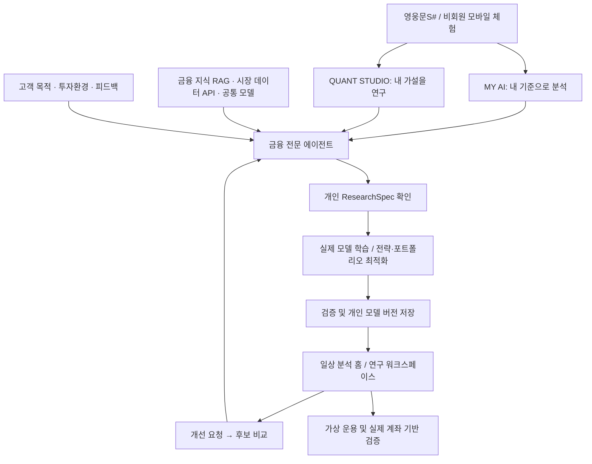
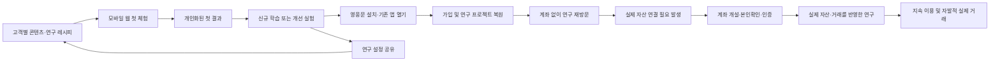
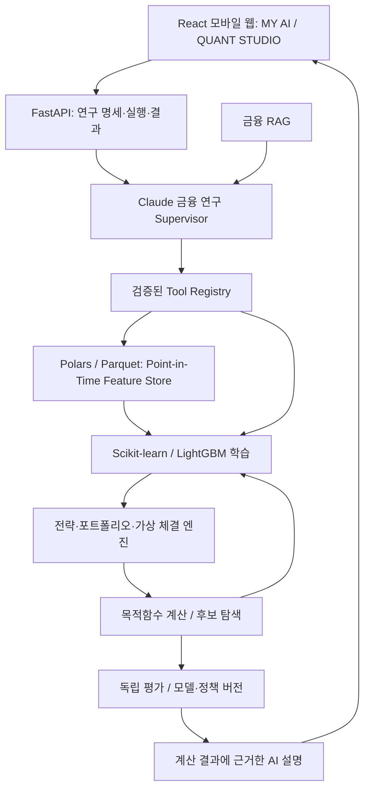

# KIWOOM AI FACTORY

## 내 투자 방식을 이해하고, 내가 원하는 방향으로 발전하는 투자 AI

**2026 신입사원 Challenge Mission | 영웅문S# 신규 서비스 제안 | v6**

> 투자자가 원하는 분석 기준을 정하면 키움의 금융 AI가 실제 데이터를 학습해 투자 모델을 만들고, 고객의 개선 요청에 따라 모델과 전략을 다시 검증한다. 일반 투자자는 간편하게 활용하고, 숙련 투자자는 연구 방법까지 직접 설계한다.

---

# PART I. Mission 1 — Make a Reason

## 1. 제안 요약: 타사 고객이 키움을 이용할 이유

이미 다른 증권사에서 주식을 거래하는 고객에게 또 하나의 시세 화면이나 AI 챗봇을 제공하는 것만으로는 앱을 바꿀 이유가 부족하다. AI FACTORY는 고객이 중요하게 생각하는 정보를 반영한 개인 투자 분석 시스템을 영웅문S#에서 만들고 관리할 수 있도록 한다.

고객은 처음부터 금융·통계 지식을 갖출 필요가 없다. 예를 들어 가격보다 기업 실적을 중요하게 보고 거래는 자주 하고 싶지 않다고 입력하면, 금융 전문 에이전트가 연구 목표와 모델 후보를 구성한다. 실제 과거 데이터를 학습한 모델의 성과와 위험을 확인한 후 고객이 “변동성이 큰 종목은 줄이고 싶다”라고 요청하면 새로운 후보 모델 또는 전략을 검증한다. 이 결과와 연구 이력은 고객 자신의 투자 도구로 축적된다.

| 제안 요소 | 내용 |
|---|---|
| 우선 타깃 | 타사 MTS에서 국내주식을 직접 매매하며 투자 기준은 있지만 분석에 충분한 시간을 쓰기 어려운 고객 |
| 해결 문제 | 투자 정보는 많지만 자신의 기준에 맞춰 분석하고 지속적으로 검증하기 어려움 |
| MY AI | 원하는 투자 방식으로 맞춰지는 간편 투자 AI. 모델링은 뒤에서 실행하고 고객은 분석 결과와 개선 방향을 이용 |
| QUANT STUDIO | 투자 가설을 실제 예측 모델로 구현하고 데이터·목적함수·운용 조건을 직접 제어하는 전문 연구 공간 |
| 공통 기반 | 금융 특화 LLM, RAG, 시장 데이터 API, 실제 ML 학습, 다목적 최적화, 백테스트 엔진 |
| 유입 동기 | 계좌 개설 전에도 자신의 AI를 만들어 기존 증권사와 병행 사용 |
| 계좌 연결 가치 | 실제 보유자산·가용 현금·주문 및 체결을 반영하여 자신의 모델을 정밀하게 평가 |
| 확산 구조 | 투자 AI의 연구 레시피 공유 → 타사 고객의 복제 및 개인화 → 신규 학습 → 영웅문 이용 |

**제품의 중심은 개인 투자 AI의 학습과 최적화다.** 백테스트는 신뢰성을 확인하는 과정, 가상 운용은 학습 모델을 신규 시장에서 시험하는 수단, 계좌 연결은 개인화와 실제 거래 분석을 확장하는 수단이다.

## 2. 공식 과제 요구사항과 제안의 대응

출처: 첨부 `★중요★신입사원 과제안내_플랫폼본부(2).pdf`, PDF 2~5페이지. 과제 문구와 아래 기획상의 답변을 구분한다.

| 과제의 요구 | 제안의 답 |
|---|---|
| Why Kiwoom? (2p) — 이미 타 증권사를 이용하는 고객에게 새로운 가치 | 기존 증권사를 변경하지 않고도 나만의 투자 AI를 생성·검증할 수 있는 모바일 투자 환경 |
| Mission 1. Make a Reason (3p) — 키움만의 새로운 서비스나 경험 | 개인 목적에 따른 실제 모델 학습과 개선 요청, 모델·전략·계좌 연결을 하나의 MTS 경험으로 제공 |
| 고객이 실제로 이용하고 싶어야 함 (3p) | 분석 부담이 있는 고객의 일상적 의사결정과 숙련 고객의 반복 연구라는 구체적인 문제를 해결하고 사용성으로 검증 |
| 서비스 매체는 모바일 (3p) | 영웅문S# 내 두 모드. 외부 모바일 웹은 서비스 체험 및 앱 유입 경로로 한정 |
| Mission 2. Spread the Reason (4p) — 고객·방법·채널·실제 앱 이용 | 고객별 연구 콘텐츠, 공유 레시피, 복제 후 실제 학습, 앱 설치·가입·계좌 연결까지 일관된 여정 |
| 고객 이해·차별성·확산 가능성·실현 가능성 (5p) | 고객 과업, 경쟁 비교, 공유 기반 전환, 실제 실행형 PoC로 각각 검증 |

안내서는 새로운 기술의 복잡성을 평가하는 과제가 아니다. 아래의 기술 구조는 고객에게 약속하는 가치를 실제로 구현할 수 있다는 근거로 제시한다.

## 3. 고객 이해: 누구에게 필요한가

### 3.1 우선 공략 고객 — MY AI

**대표 페르소나: 타사 MTS를 사용하는 직장인 직접투자자.** 관심종목을 보유하고 주기적으로 시세를 확인하지만 매번 재무정보와 가격 흐름을 비교할 시간이 부족하다. 스스로 중요하게 생각하는 기준이 있으며 단순 인기종목 목록이나 시장 요약만으로는 원하는 판단을 하기 어렵다. 이는 검증할 고객 가설이며 연령·직업 전체의 일반적 특성으로 단정하지 않는다.

- 현재 행동: 익숙한 MTS에서 시세 확인 → 검색·뉴스·실적 확인 → 스스로 비교 → 매수 여부 판단.
- 불편: 매일 같은 정보를 찾아야 하고 자기 투자 기준의 유효성을 확인하기 어렵다.
- 전환의 계기: 별도 계좌를 요구하지 않는 개인 AI 체험에서 자신의 기준에 맞는 분석을 바로 확인한다.
- 재방문의 이유: 내 기준으로 구성된 분석 결과의 변화, 가상 운용 결과 및 개선 전후 비교를 한 화면에서 확인한다.
- 초기 고객 목표: 분석을 위해 코딩하거나 긴 설문을 작성하지 않고, 두세 가지 선택만으로 첫 유용한 결과를 얻는 것.

모든 일반 개인투자자가 투자 모델을 만들고 싶어 한다고 가정하지 않는다. 편리한 주문만 원하는 고객, 투자에 관심이 없는 고객은 초기 타깃에서 제외한다. 일반 모드의 주인공은 AI 개발자가 아니라 **본인의 투자 방식을 유지하면서 분석에 필요한 시간과 노력을 줄이고 싶은 고객**이다.

### 3.2 확장 고객 — QUANT STUDIO

타사 MTS와 엑셀·조건검색·퀀트 도구·Python 등을 병행하는 적극적 투자자를 대상으로 한다. 투자 가설을 반복적으로 실험하고 싶지만 데이터 수집 및 계산 환경을 직접 구축하는 데 비용이 든다. GOOD LUCK 소스에 나타난 데이터 수집, 변수 생성, 모델 학습, 실행 시뮬레이션 및 반복 실험 과정은 이 고객의 진입장벽을 구체화하는 참고 사례다.

이 고객군은 연구 레시피를 만들고 공유하는 초기 공급자 역할도 한다. 다만 법률상 전문투자자 자격과 분석 숙련도는 별개다.

| | MY AI | QUANT STUDIO |
|---|---|---|
| 고객의 질문 | 내 기준으로 시장을 쉽게 살펴볼 수 있을까? | 내 가설을 모델로 구현하고 검증할 수 있을까? |
| 고객의 목적 | 투자 분석 편의 | 투자 연구 및 모델 개선 |
| 현재 대안 | MTS, 포털, 투자 콘텐츠, 범용 AI | 조건검색, 엑셀, 개발 환경, 퀀트 플랫폼 |
| 제공할 가치 | 원하는 방향만 표현하면 분석 방식이 실제로 달라짐 | 데이터·Target·모델·목적함수·거래 정책을 직접 설계 |
| 주 이용 빈도 가설 | 시장 확인 시 짧게 방문 | 가설·시장 변화에 맞춘 연구 세션 |
| 유입 우선순위 | 폭넓은 고객 접근을 위한 주력 경험 | 고관여 고객 확보 및 연구 레시피 확산 |

## 4. 서비스 전체 구조



두 모드는 동일한 엔진에 대한 제어권과 고객 경험이 다르다. 일반 모드가 단순 뉴스 서비스가 되거나 전문 모드가 별도의 PC 코딩 도구가 되지 않도록 한다. 두 모드 모두 모바일에서 동일한 연구 명세·모델·검증 데이터를 이용한다.

## 5. SERVICE A — MY AI

### 5.1 고객에게 약속하는 경험

**내가 중요하게 생각하는 기준대로 투자 정보를 분석해 주는 AI. 그 기준을 바꾸면 실제 분석 방식도 바뀐다.** 고객은 학습 알고리즘을 조작하기 위해 앱을 열지 않는다. 오늘 무엇을 확인해야 할지, 자신의 기준에 맞는 분석은 무엇인지 확인하기 위해 앱을 연다. 모델 학습은 이를 지원한다.

### 5.2 최초 진입: 계좌 없이 바로 시작

첫 화면에는 기존 고객 시작, 계좌 개설, `내 AI 체험`을 제공한다. 현재 가입·인증 흐름을 무조건 변경할 수 있다고 전제하지 않고 비회원 연구 영역을 신규 제안한다.

1. 사전 연구 예시를 선택하면 공통 모델의 검증 결과를 즉시 볼 수 있다. 기존 계산 결과임을 표시한다.
2. 고객은 `어떤 정보를 중요하게 보나요?`와 `얼마나 오래 투자하나요?` 두 가지를 선택하거나 일상 언어로 입력한다.
3. 금융 에이전트가 분석 목표와 사용 데이터, 기본 정책을 제시한다. 고객은 확인 또는 수정한다.
4. `내 기준 적용`을 누르면 지원 가능한 조합의 신규 모델 학습 또는 동일 명세의 기존 모델 재사용과 개인별 정책 검증이 이루어진다. 추가로 투자금·관심종목·가상 보유자산을 넣는 것은 선택이다.

```text
┌─────────────────────────┐
│ 영웅문S#     MY AI      │
│ 내 방식으로 시장을 살펴보기 │
│                         │
│ 어떤 정보를 중요하게 보나요? │
│ [기업 실적] [가격 흐름]     │
│ [배당]     [하락 위험]     │
│ 평소 얼마나 보유하나요?     │
│ [며칠] [몇 주] [몇 달 이상] │
│                         │
│ [내 기준 적용하기]          │
│ 예시 AI 먼저 보기           │
└─────────────────────────┘
```

화면은 기획 와이어프레임이다. 서비스의 전체 지원 목표이며 초기 PoC에서 실제 지원하는 선택지는 확보 데이터 및 모델에 맞게 표시한다. 배당·재무·장기 예측을 시연하기 위한 자료가 없는 경우 선택 불가능 상태와 이유를 표시한다.

### 5.3 매일 사용하는 홈: 결과 먼저, 연구는 뒤에서

```text
┌─────────────────────────┐
│ MY AI          [설정]   │
│ 내 기준: 기업 실적 · 장기    │
│ 오늘 확인할 내용            │
│  · 내 기준에 따른 종목 분석  │
│  · 보유자산의 집중도 변화    │
│  · 검증 및 가상운용 현황     │
│                         │
│ 내 AI를 바꿔볼까요?         │
│ [큰 손실 줄이기]           │
│ [거래 횟수 줄이기]          │
│ [다른 정보 반영하기]        │
│                         │
│ 홈 | 내 AI | 성과 | 계좌    │
└─────────────────────────┘
```

| 기능 | 고객에게 보이는 것 | 실제 내부 동작 |
|---|---|---|
| 내 기준으로 종목 분석 | 분석 항목, 해당 종목의 근거와 불확실성 | 고객 모델의 기준일별 예측 및 특징, 전략 필터, 데이터 근거 연결 |
| 내 자산 분석 | 보유자산 집중도, 가용 현금과 운용 조건 | 포트폴리오 제약·위험 분석. 계좌 없이 수동 입력 가능 |
| 내 AI의 성과 | 기간별 평가금액, 손실 구간, 비교 기준 | 과거 검증·가상 원장과 공통 벤치마크 계산 |
| 원하는 방향으로 개선 | 일상어 개선 버튼 또는 자연어 요청 | ResearchSpec 변경, 후보 학습 또는 정책 재최적화 |
| 버전 비교 | 무엇이 달라졌는지, 더 좋아진 점과 나빠진 점 | 동일 평가 기준으로 후보 비교. 기존 모델 유지 가능 |

현재 시점의 개인별 종목 추천은 제품의 확장 기능이다. 초기 과거 연구 화면은 `연구 기준일`을 항상 표시하고 해당 시점의 과거 후보만 보여준다. 현재 거래에 대한 권유와 혼동하지 않도록 연구 결과를 구분한다.

### 5.4 실제 개선 경험 — 고객은 방법이 아닌 방향을 결정

**예시:** “가격 변동이 너무 큰 종목은 줄이고 싶어요.”

에이전트는 고객에게 다음 연구 계획을 보여 준다.

- 기존 모델 V1 유지 + 변동성 필터를 추가한 전략 후보 P2.
- 가격 및 거래량 특징에 위험 특징을 추가하고 새로 학습한 모델 후보 M2.
- 동일한 검증 구간에서 수익률·낙폭·거래 횟수·비용을 비교한다. 미래 손실 한도를 보장하지 않는다.

```text
내 AI의 개선 결과 (가상 화면 예시)
                기존 V1     새 후보 V2
평가금액         112만원     109만원
과거 최대 낙폭     -18%        -11%
거래 횟수          24회         18회

큰 손실이 발생한 구간은 줄었지만
최종 평가금액은 낮아졌습니다.
[기존 유지] [새 후보를 가상으로 시험]
```

위 수치는 서비스 화면의 형태를 설명하기 위한 임의 예시이며 실제 성과가 아니다. 학습·검증 엔진에서 계산한 숫자만 실제 제품에 표시한다. 고객이 비중이나 거래 횟수만 변경한 경우에는 예측 모델을 재학습하지 않을 수 있다. 화면에는 `모델 재학습`과 `운용 방식 변경`을 쉽게 구분한다.

### 5.5 일반 고객의 일상적 가치와 전환 조건

초기 학습 자체는 한 번의 행동이다. 지속 이용은 고객의 기준으로 재구성된 시장·자산 분석, 이전 AI와 새 후보의 비교, 신규 데이터로 확인하는 가상 운용 현황에서 나온다. 매일 재학습을 요구하거나 거래를 늘리는 방향으로 알림을 설계하지 않는다.

계좌를 연결하지 않아도 시장 데이터 기반 연구와 가상 포트폴리오를 이용한다. 실제 자산을 반영하는 과정이 번거로워지는 시점에 키움계좌 연결을 안내한다. 계좌 연결 후에도 기존 연구와 버전 기록이 그대로 이어진다.

## 6. SERVICE B — QUANT STUDIO

### 6.1 서비스 정의

**데이터부터 예측 모델·전략·포트폴리오까지 고객이 직접 구성하고 AI와 함께 개선하는 모바일 연구 공간.** 일반 모드에서는 원하는 결과를 표현하지만 전문 모드에서는 연구 방법까지 결정한다. 별도의 개발 서버를 준비하지 않고 자신의 가설을 실행 가능한 연구 명세로 변환할 수 있다.

### 6.2 연구 공간과 기능

```text
┌──────────────────────────┐
│ QUANT STUDIO    Project A │
│ 모델 V3 · 연구 기준일      │
│ [데이터] [Target] [모델]    │
│ [전략] [최적화] [검증]      │
│                          │
│ 연구 결과                  │
│ OOS 성과 / MDD / 비용      │
│ V1 · V2 · V3 비교 차트     │
│                          │
│ AI에게 연구 요청            │
│ [수급 변수 추가 효과 검증]   │
│                          │
│ 연구 | 검증 | 버전 | 운용    │
└──────────────────────────┘
```

복잡한 표를 한 화면에 전부 넣지 않고 단계형 편집 화면과 접을 수 있는 상세 지표를 제공한다. PC는 선택적 보조 도구가 될 수 있으나 본 제안과 PoC의 핵심 과업은 모바일에서 완료할 수 있어야 한다.

| 연구 영역 | 고객 제어권 | AI 지원 |
|---|---|---|
| Universe | 시장·종목군·업종·유동성 | 가용한 종목군과 시점별 범위 확인 |
| Data & Feature | 가격·거래량·수급·재무, 개별 변수 및 허용 함수 조합 | 결측·가용 시점·변수 후보 설명 |
| Target | 미래 수익률, 초과수익률, 사건 발생 여부, 위험 | 예측 시점과 Label 정의, 매매 규칙의 정합성 확인 |
| Model | 회귀·분류·순위 모델, 학습기간·가중치·파라미터 | 기준 모델과 제한된 후보 실험 구성 |
| Strategy | 신호 임계값, Top-K, 보유 기간, 진입·청산 조건 | 실제 주문 조건을 고려한 시뮬레이션 |
| Optimization | 고객 정의 목표·가중치·제약조건 | 후보 탐색, Pareto 비교, 개선 실패 기록 |
| Validation | Walk-forward, OOS, 기간별 성과·민감도 | 미래정보 누출, 과적합, 체결 가정 검사 |
| Portfolio | 현금, 보유자산, 종목·업종 비중, 회전율 | 개인 자산 제약에 따른 정책 검증 |
| Model Registry | 모델·전략 별도 버전, 재실험, 복제 | 변경사항·근거·실패 이력 요약 |

### 6.3 GOOD LUCK 기반 대표 연구 시나리오

고객의 요청: “국내주식 중 다음 5거래일 수익률을 분석하고 싶다. 가격·거래량부터 학습하고, 수급을 더했을 때 비용 차감 성과가 개선되는지 비교해 줘.”

1. 에이전트가 기준일·진입·청산·학습 구간을 확인하여 Target을 확정한다.
2. Ridge와 LightGBM 등 지원 모델로 가격·거래량 기준선을 학습한다.
3. 수급 데이터의 이용 가능 시점과 범위를 확인하고 후보 모델을 별도 학습한다. 수급이 없으면 위험 특징 실험으로 변경하고 그 이유를 표시한다.
4. 동일한 개발 구간에서 모델·전략 후보를 비교하고 미사용 평가 구간은 후보 선택에 이용하지 않는다.
5. 비용·회전율·위험을 비교하고 선택한 모델과 독립된 대안 모델을 함께 저장한다.
6. 고객이 새 연구를 요청할 때 이전 실험을 재사용한다. 실제 개선이 확인되지 않으면 기존 모델을 유지한다.

전문 모드의 효용은 수익률의 크기가 아니라 연구 수행 시간과 자유도, 재현 가능성이다. 검증되지 않은 모델을 실계좌에 자동으로 적용하는 기능은 초기 범위에 두지 않는다.

## 7. 일반·전문 투자자별 기능과 UI의 실질적 차이

| 구분 | MY AI | QUANT STUDIO |
|---|---|---|
| 첫 진입 | 예시 AI 즉시 체험, 2~3개 선택 | 연구 템플릿 또는 새 프로젝트 |
| 일상 화면 | 분석 결과·자산 현황·쉬운 개선 버튼 | 실험 현황·모델 비교·검증·버전 |
| 연구 입력 | 관심사·투자 기간·개선 방향 | 자연어 + 상세 ResearchSpec 편집 |
| 데이터 | 관심 정보 그룹 단위 | 개별 변수 및 파생변수 |
| 모델 | 승인된 소수 후보의 실제 학습·재사용 | 알고리즘과 학습 조건 직접 설정 |
| 최적화 | 손실 줄이기, 거래 줄이기 등 | 목적함수·제약·탐색 범위 직접 제어 |
| 기간별 결과 | 금액·낙폭·손실 사례 중심 | 성과 분포, MDD, Sharpe, 회전율, 예측 오차 |
| 모델 개선 | 이전/후보의 변화 설명 | ablation·파라미터 민감도·후보 Pareto 비교 |
| 투자 환경 | 투자금·보유종목 선택 입력 | 비중, 비용, 유동성, 체결, 현금 정책 |
| 가상 운용 | 대표 모델의 진행 상태 | 복수 후보 및 기준 모델 병렬 시험 |
| 공유 | 관심 기준 및 연구 방향을 쉽게 공유 | 연구 명세와 재현 조건을 포함한 레시피 |

일반 모드에서 전문 모드로 이동하면 동일 연구의 세부 명세를 이어서 편집할 수 있다. 전문 고객의 연구 레시피도 일반 모드에서 지원 가능한 제한된 입력으로 복제할 수 있다. 두 모드의 고객이 동일 명세와 동일 데이터·시드를 사용하면 검증 결과는 일치해야 한다.

## 8. 경쟁 서비스 분석 및 차별화

### 8.1 경쟁 기능의 사실 확인

아래는 2026-11-25에 다시 확인한 공식 공개 문서 중심 비교다. 실제 앱을 모두 설치해 실측한 결과가 아니며 확인하지 못한 기능을 없다고 표시하지 않는다.

| 서비스 | 공개 문서에서 확인한 기능 | 본 제안과의 관계 |
|---|---|---|
| 키움 영웅문4 / REST API | 고객 조건식으로 매매 시뮬레이션, API 및 AI 개발 지원 [1~3] | 기존 고객 주도 연구를 MTS 내 실제 ML 학습으로 확장 |
| 한국투자증권 KIS Developers | 시각적 전략 빌더, YAML 기반 설정, 개발 도구 및 주문 연결 [4] | 전략 연구 환경이라는 점에서 유사. 모바일 간편 학습과 개선 과업의 차이를 입증할 필요 |
| Composer | 자연어로 전략 작성·수정 및 백테스트 [5] | 자연어 전략 생성은 차별점이 될 수 없음 |
| Quant-Builder.ai | 노코드 ML 학습, Universe·Target·Feature·모델 선택, 종목 점수, 백테스트, 브로커 연계 [6] | 가장 가까운 경쟁 사례. 공식 설명은 수수료·슬리피지 미반영을 명시하므로 해당 문서 범위에서 실행 현실성의 비교 가능 |
| QuantConnect | AI 연구 에이전트, 모델·알고리즘 개발, 백테스트·최적화, 연구 프로젝트 [7] | 에이전트와 반복 최적화도 기존 기능. 비개발자용 간편 MTS 경험과 증권사 계좌 기반 연구 연결에 집중 |

국내 AI 종목 정보·뉴스·투자 챗봇 등도 넓은 의미의 경쟁 서비스지만 단순 설명이나 맞춤 정보 자체를 제안의 신규성으로 내세우지 않는다.

### 8.2 신규성의 핵심: 개인화가 실제 계산을 변경하는 MTS

| 차별화 과업 | 고객에게 제공할 구체적 결과 |
|---|---|
| 첫 유용한 결과 | 계좌 없는 모바일 진입 → 내 기준 선택 → 즉시 기본 결과 확인 → 실제 맞춤 학습 |
| 개선 요청의 실행 | 일상어 요청 하나가 실제 Feature·Target·전략·목적함수 중 필요한 항목의 변경으로 연결 |
| 지속되는 투자 AI | 학습된 모델과 전략 정책, 성공·실패 연구 이력, 기준일별 검증이 고객별로 축적 |
| 서로 다른 고객 경험 | 일반 투자자가 같은 엔진을 사용하면서 연구 부담을 줄이고, 숙련 고객은 세부 명세를 직접 제어 |
| 계좌 기반 정밀화 | 고객 동의하에 자신의 보유자산·주문·체결·비용을 이용하여 연구와 실행 사이의 차이를 분석 |
| 유입 가능한 제품 자체 | 연구 설정을 공유하고 타사 고객이 계좌 없이 자신의 조건으로 다시 학습 |

하나의 기능이 최초라는 주장이 아니라 **국내 모바일 증권 서비스에서 이 고객 과업들을 통합하는 경험**을 신규성의 대상으로 삼는다. 가장 유사한 경쟁 서비스에 같은 과업을 적용하여 모바일 지원, 신규 학습 여부, 실제 개선 요청 처리, 개인 계좌 연결, 완료 시간을 비교해야 한다. 이 비교를 통해 실제 차이가 확인될 때만 확정적인 표현을 사용한다.

### 8.3 Why Kiwoom — 왜 키움에서 실행하는가

키움의 기존 자산은 고객이 자신의 투자 방식을 만들고 실행할 수 있도록 지원하는 인프라다. 조건검색·계좌 시뮬레이션·REST API·AI 개발 도구는 공식 자료에서 확인된다. [1~3] 이 기반을 이용해 개발자 중심 투자 개발 경험을 일반 고객에게까지 확장한다.

| 키움의 기반 | AI FACTORY에서 구현할 가치 | 경쟁력의 성격 |
|---|---|---|
| 조건검색 및 성과검증 | 규칙 기반 기준선과 ML 모델 비교, 기존 투자 기능 연결 | 검증과 기능 통합의 비용 감소 |
| REST API 및 AI 개발 지원 | 금융 에이전트의 도구·데이터 연계 | 기존 금융 개발 자산 활용 |
| 간편·일반 MTS 경험 | MY AI와 QUANT STUDIO의 서로 다른 제어권 | 기존 모바일 고객 접점 활용 |
| 자사 계좌 및 고객 자신의 체결 기록 | 가상 거래와 실제 실행의 비용·미체결·시점 차이 진단 | 고객의 투자 환경에 맞춘 정밀화 |
| LG AI연구원·LSEG 금융 AI 협력 | 금융 전문 분석 및 설명 역량과 연계 가능 [8] | 기존 AI 전략과의 접점. 사용 권한은 별도 확인 |

타사도 유사 기술을 개발할 수 있다. 따라서 지속적인 경쟁력은 모델 자체의 독점보다는 연구 데이터와 거래 인프라의 연결, 검증된 연구 도구, 고객이 축적하는 모델·실험의 연속성에서 확보한다. 고객의 실제 체결 데이터가 예측 모델의 수익성을 반드시 개선한다는 가정은 두지 않는다. 계좌 연결 전에 이미 독립된 연구 효용을 제공해야 한다.

---
# PART II. Mission 2 — Spread the Reason

## 9. 고객 확산: 연구 레시피를 제품의 유입 경로로

### 9.1 홍보 메시지와 채널

두 고객군에 같은 광고를 집행하지 않는다. 일반 고객은 투자 정보가 필요한 순간에, 적극 고객은 가설을 검증하고 싶은 순간에 진입하도록 한다.

| 고객 | 메시지 | 고객이 이미 있는 접점 | 체험 연결 |
|---|---|---|---|
| MY AI | 내 투자 기준대로 분석해 주는 AI, 계좌 없이 먼저 체험하세요 | 국내주식 정보 검색, 투자 입문·직장인 재테크 콘텐츠, 짧은 영상 | 콘텐츠에서 사용한 AI 설정을 열고 자신의 기준 한 가지를 변경 |
| QUANT STUDIO | 내 투자 가설을 데이터와 모델로 검증하세요 | 증권사 API 이용자 커뮤니티, 퀀트 연구자, 개발자센터, 투자 연구 크리에이터 | 실제 연구 레시피를 열고 Feature 또는 목적함수를 변경해 재실행 |

검색광고·영상·커뮤니티 자체가 전략의 핵심은 아니다. 광고나 콘텐츠의 소재가 직접 실행 가능한 투자 연구가 되고, 고객이 동일한 연구를 자신의 조건으로 재현하는 것이 핵심이다.

### 9.2 핵심 확산 기능: AI Recipe Fork

숙련 고객이 연구 설정을 공유하면 일반 고객은 이를 간단한 입력으로 개인화하고, 숙련 고객은 세부 내용을 수정할 수 있다. 공유 대상은 모델의 투자 권유나 수익률 순위가 아니라 공개가 허용된 데이터 그룹, Target, 전략 가정과 연구 목적이다. 공유 대상에서 개인 자산, 거래내역, 실시간 매수·매도 신호는 제외한다.

```text
┌──────────────────────────┐
│ KIWOOM AI FACTORY        │
│ 직장인을 위한 저빈도 연구 AI │
│                          │
│ 연구 목표: 20일 가격 변화   │
│ 중요 기준: 거래 부담과 위험 │
│ 사용 정보: 가격·변동성      │
│ 가상 운용: 주 1회 점검      │
│                          │
│ [내 기준으로 다시 만들기]    │
│ [상세 연구 명세 보기]        │
└──────────────────────────┘
```

공유를 받은 고객은 연구 설정을 자신의 작업 공간으로 복제하고 자신의 기간·관심 데이터·투자금·제약을 수정할 수 있다. 사전 학습 결과를 그대로 제공하는 것과 새로 모델을 학습시키는 것을 표시한다. 일반 모드로 가져갈 수 없는 고급 연구 설정은 제한된 템플릿으로 변환하는 내용을 확인시킨다. 별도의 투자자문 및 광고 검토가 필요한 공유 콘텐츠는 공개하지 않는다.

**캠페인 예시 A — MY AI:** 투자 콘텐츠에서 “매일 매매하기 어려운 직장인이라면 어떤 정보를 더 중요하게 볼까?”를 주제로 실제 연구 예시를 공개한다. 영상의 링크에서 고객이 거래 빈도 또는 변동성 기준을 바꾸면 자신의 비교 결과가 생성된다. 결과를 이어서 확인하려면 영웅문을 설치하고 연구 공간을 복원한다.

**캠페인 예시 B — QUANT STUDIO:** API·퀀트 커뮤니티에 “가격·거래량만 사용한 모델과 위험 특징을 추가한 모델의 차이”라는 재현 가능한 실험을 공개한다. 고객은 링크에서 동일한 명세를 열고 자신의 예측 기간 또는 Feature를 바꾸어 실험한다. 성공뿐 아니라 실패한 가설도 공개하여 과장된 성과 홍보와 구분한다.

### 9.3 실제 앱 이용 및 계좌 개설로 이어지는 여정



| 단계 | 고객의 실제 행동 | 다음 단계로 넘어가는 이유 | 평가 지표 |
|---|---|---|---|
| 인지 | 링크·QR·공유 카드 열기 | 자신의 투자 질문과 연결된 구체적인 체험 | 콘텐츠 클릭률, 유효 방문 |
| 첫 체험 | 기존 예시 확인 및 목적 선택 | 계좌 없이 내 투자 기준을 적용 가능 | 첫 결과 완료율, 결과까지의 시간 |
| 개인 학습 | 명세 확인, 학습, 개선 요청 | 실제로 다른 결과가 생성됨 | 학습 완료율, 개선 실행률 |
| 설치 | 영웅문 앱으로 이동 | 프로젝트를 이어서 확인하고 관리 | 설치 전환율, 프로젝트 복원율 |
| 가입·인증 | 연구 저장에 필요한 등록 절차 완료 | 자신의 연구 이력을 지속 관리 | 가입 및 복원 성공률 |
| 재방문 | 모델 변경·새로운 시장 검증 확인 | 자신의 투자 AI가 지속적으로 이용 가능 | D7·D30 연구 활성률 |
| 계좌 개설 | 고객이 실제 자산 연계를 선택, 기존 개설·본인확인·인증 절차 수행 | 수동 입력 감소 및 실제 자산·실행 조건 분석 | 계좌 개설 완료율, 연결 활성률 |
| 실제 사용 | 계좌 조회, 위험 분석, 검토 후 기존 거래 기능 이용 | 투자 연구와 거래 환경을 한 앱에서 관리 | 활성 계좌, 순유입 자산, 연구 후 지속 이용 |

웹에서 앱으로 이동할 때 연구 명세와 프로젝트를 복원하는 연결 기능이 필요하다. 설치가 계좌 개설의 강제 수단이 되지 않도록 한다. 기존 계좌 이용자도 앱에서 동일한 연구 경험을 이용한다. 실제 거래는 고객의 필요와 적법하게 제공되는 기능에 따라 이루어지며 거래 횟수 증대를 목표로 삼지 않는다.

### 9.4 성과 지표와 사업 가설

최종 성과는 `타사 이용 경험이 있는 신규 고객 중 연구를 완료하고 30일 이내 다시 유효하게 이용한 고객 수`를 중심으로 본다. 계좌 개설·실제 자산 연결·순유입 자산은 사업 성과로 함께 본다. 신규 고객 수나 전환율은 아직 실측하지 않았으므로 목표치를 실적처럼 제시하지 않는다.

- 일반 고객 가설: 기존 방식 대비 원하는 기준에 맞는 분석을 더 적은 조작으로 얻고 개선 요청을 이해할 수 있다.
- 숙련 고객 가설: 직접 구축하는 과정 대비 투자 가설의 학습·검증에 필요한 시간이 줄어들고 반복 연구 의향이 높아진다.
- 공유 가설: 일반 홍보 페이지보다 실행 가능한 연구 레시피가 첫 연구 완료율을 높인다.
- 전환 가설: 계좌 개설을 먼저 요구하는 방식보다 연구 가치를 먼저 경험한 고객이 자발적으로 설치·가입·계좌 연결을 선택할 가능성이 높다.

---

# PART III. 서비스 구현의 핵심 — AI·데이터·개인화 아키텍처

## 10. 공통 금융 전문 AI 에이전트 (Shared Financial Intelligence)

### 10.1 구축 목표

공통 에이전트는 일반적인 금융 Q&A 챗봇이 아니라 **투자 전략 연구, 종목 분석 및 후보 선별에 특화된 연구 실행 에이전트**다. 금융 전문 지식에 기반하여 고객의 목표를 이해하고 전략 가설을 세우며 데이터를 조회하고 모델을 학습시키고 실험 결과를 해석할 수 있어야 한다.

에이전트의 추천 역량은 자연어 생성만으로 구현하지 않는다. 종목의 정량적 평가 및 순위는 시점별 실제 금융 데이터와 검증된 모델·규칙으로 계산하고, 에이전트는 적합한 연구 방법을 선택하거나 결과의 근거를 설명한다. 이 공통 역량을 고객별 연구 모델의 기반으로 활용한다.

### 10.2 금융 전문성 구축 방식

| 구성 | 역할 | 구체적 내용 |
|---|---|---|
| Foundation LLM | 금융 연구 요청 이해 및 추론 | Claude API 기반 에이전트, 다른 모델로 교체 가능하도록 구성 |
| Financial RAG | 금융 지식 및 전략 근거 검색 | 투자 전략 개념, 금융·퀀트 연구, 거래제도, 통계 검증 방법, 키움 기능 매뉴얼 |
| Data API | 시점별 사실과 숫자 제공 | 주가·수급·공시·재무·지수·거시 데이터 및 계좌 조회 인터페이스 |
| Research Tools | 실제 학습·계산·검증 | Feature 생성, ML 학습, 종목 평가, 백테스트, 최적화, 포트폴리오 분석 |
| Base Model Library | 재사용 가능한 금융 분석 모델 | 기간·Target별 검증된 회귀·분류·위험 모델과 비교 전략 |
| Financial Evals | 에이전트의 금융 연구 능력 검증 | 요청 해석 정확도, 출처 일치, 데이터 가용 시점, 누출 탐지, 계산 결과 일치 |

**RAG의 역할:** 전략을 검색하고 해당 전략의 가정, 적용 조건, 연구 방법을 설명한다. 금융지표 값이나 실시간 시세는 RAG 문서가 아닌 데이터 API에서 가져온다. 검색한 문서의 출처·공개 시점을 남긴다.

**Tool Calling의 역할:** 모델 학습, 후보 선별, 수익률 계산 등 실제 금융 분석 작업을 Python 엔진에 위임한다. 에이전트는 실행 계획을 수립하고 결과를 읽어 다음 연구를 설계한다. 수익률과 종목 점수를 LLM 텍스트 생성으로 대신하지 않는다.

**Fine-tuning의 역할:** 충분한 품질의 금융 연구 요청–실험 계획–도구 호출–검증 결과 데이터가 축적될 경우 금융 연구 계획 수립과 도구 선택 정확도를 높이는 방향으로 검토한다. 최신 시세를 LLM의 가중치에 학습시키는 방식은 사용 목적과 맞지 않는다. 초기 PoC는 RAG·Tool Calling·금융 특화 Evals로 공통 에이전트를 구현한다. 실제 개인별 학습은 별도의 ML 모델에서 이루어진다.

### 10.3 금융 연구 지식베이스의 구성

| 주제 | 지식 내용 | 사용 예 |
|---|---|---|
| 투자 전략 | 가치·성장·모멘텀·평균회귀·배당·자산배분 | 고객 목적에 맞는 검증 가능한 연구 가설 구성 |
| 시장 구조 | 거래시간, 호가, 유동성, 기업행위, 거래비용 | 실행 가정의 현실성 검토 |
| 금융 지표 | 재무제표, 밸류에이션, 수급, 변동성 | 변수 해석 및 데이터 선택 |
| ML 연구 | Feature Engineering, Target Engineering, 회귀·분류·순위학습 | 예측 문제와 모델 후보 정의 |
| 평가 방법 | 시계열 분할, Walk-forward, 과적합, 누출, 생존편향 | 연구 명세와 실험 결과 검토 |
| 포트폴리오 | 위험 기여도, 집중도, 상관관계, 현금 및 비중 제한 | 고객 자산을 고려한 연구 조건 구성 |
| 키움 인프라 | 조건검색, 성과검증, REST API, 주문 유형 | 연구 결과와 증권 서비스 연결 |

지식베이스에는 검증 가능한 문서와 출처를 사용한다. 금융 논문이나 전략 설명이 존재한다는 사실만으로 수익성을 인정하지 않고, 별도의 실제 데이터 검증을 수행한다.

### 10.4 종목 분석과 후보 선별 엔진

공통 에이전트는 다음 순서로 전략 및 종목을 분석한다.

1. 고객이 정한 시장, 종목군, 투자 기간 및 데이터 범위 확정.
2. 결정 시점에 이용 가능했던 시세·수급·재무 특징 계산.
3. 해당 Target을 학습한 공통 또는 개인 모델로 종목별 예측값·위험 점수 계산.
4. 거래 가능 종목과 유동성 등 연구 대상 조건 필터링.
5. 고객의 투자금·보유자산·집중도·거래 제약을 별도의 전략·포트폴리오 층에 적용.
6. 선택된 후보와 점수, 모델 근거, 가정, 과거 검증 결과를 연결하여 설명.

예를 들어 5거래일 초과수익률 모델은 해당 기간의 예측값을, 하락 위험 모델은 정의된 손실 사건의 추정 확률을 산출한다. 서로 다른 예측 목표의 점수를 같은 단위의 수익률로 오인하지 않도록 한다. 확률은 별도 보정 및 검증을 거친 경우에만 확률로 해석한다. 모델의 특징 중요도와 개별 예측 설명은 인과적 근거와 구분한다.

초기 체험은 과거 기준일의 종목 선별과 검증을 제공한다. 실제 현재 종목의 개인별 매수·매도 추천이나 주문 실행은 상용 서비스의 별도 기능 범위로 다룬다(15절).

---

## 11. 공통과 개인의 경계 — Personal Investment AI Architecture

### 11.1 공유할 것과 개인별로 달라질 것

| 구성 요소 | 키움 공통 영역 | 고객 개인 영역 |
|---|---|---|
| LLM | 금융 전문 에이전트의 지능·도구 사용 방식 | 연구 요청, 대화 맥락, 명시된 선호 및 피드백 |
| 지식 | 금융 RAG와 연구 방법 | 관심 전략·고객 작성 가설 및 연구 기록 |
| 시장 데이터 | 시점별 공통 데이터마트 | 고객이 연구 대상으로 선택한 데이터·시장·종목군 |
| 변수 | 표준 Feature Store와 변수 생성 함수 | 데이터 그룹, 개별 변수, 허용된 파생변수 조합 |
| 예측 목표 | 검증 가능한 Target의 정의와 계산 방식 | 투자 기간·예측 대상·Label 설정 |
| 알고리즘 | 검증된 학습 알고리즘과 기본 모델 | 학습 데이터·가중치·파라미터·모델 아티팩트 |
| 검증 | 공통 백테스트·체결·평가 엔진 | 연구 기간, 거래 규칙, 투자금 및 비용 가정 |
| 최적화 | 공통 후보 탐색·제약 검사·평가 로직 | 목적함수, 허용 위험, 거래 빈도·종목 수·비중 |
| 포트폴리오 | 위험 측정·비중 계산 도구 | 실제 또는 가상 보유자산, 현금, 투자 일정 |
| 모델 관리 | Model Registry의 공통 형식 | 고객이 소유하는 연구 프로젝트·버전·실험 이력 |

고객별로 LLM 전체를 재학습할 필요는 없다. 하나의 공통 금융 에이전트가 여러 독립된 연구 공간을 지원하고, 각 고객의 연구 명세에 따라 학습된 ML 모델 및 정책을 관리한다. 동일한 학습 설정을 이용하는 고객은 계산된 모델을 재사용할 수 있지만, 포트폴리오·최적화 조건·연구 이력은 개인별로 유지한다.

### 11.2 개인 투자 AI의 실체

개인 투자 AI를 다음 여섯 요소의 조합으로 정의한다.

```text
PersonalInvestmentAI
├── ResearchProfile   : 고객 목적·선호·연구 가설
├── ModelSpec         : Universe, Feature, Target, 알고리즘, 학습 범위
├── ModelArtifact     : 실제 학습된 모델 파라미터·버전
├── StrategyPolicy    : 신호 처리, 종목 수, 보유 기간, 매매 및 비용 조건
├── PortfolioPolicy   : 보유자산, 현금, 투자금, 비중 및 위험 제약
└── ResearchHistory   : 학습 로그, 검증 결과, 개선 요청, 후보 비교
```

모델 이름만 다르고 실제 내부가 같다면 개인화된 학습 모델이라고 부르지 않는다. 반대로 기존 모델의 예측값을 유지하면서 개인별 비중 정책만 바꾸는 경우도 의미 있는 개인화다. UI와 연구 기록에서 **모델 학습 / 전략 최적화 / 포트폴리오 최적화**를 구분한다.

### 11.3 개인 정보가 계산의 어느 부분에 반영되는가

| 고객 정보 | 실제 반영 층 | 예시 |
|---|---|---|
| 투자 목적 | Target + 평가 기준 | 단기 순수익률 vs 60일 상대수익률 vs 하락 위험 |
| 투자 기간 | Target + 검증 및 운용 주기 | 1·5·20·60거래일 예측, 월간 리밸런싱 |
| 관심 데이터 | 학습 특징 및 모델 | 가격만 vs 가격+수급 vs 가격+위험 특징 |
| 관심 시장·업종 | Universe | 국내주식, 특정 업종, 고객이 지정한 종목군 |
| 위험 선호 | 목적함수 + 전략 제약 | MDD 페널티, 변동성·집중도 한도 |
| 투자 가능 시간 | 전략·체결 정책 | 장중 대응 제한, 종가 신호 후 다음 거래일 실행 |
| 투자금·납입·인출 | 포트폴리오 및 현금흐름 시뮬레이션 | 월 50만원 납입, 투자 가능 현금 제한 |
| 보유종목·업종 비중 | 포트폴리오 제약 | 반도체 비중 상한, 기존 종목 중복 관리 |
| 거래비용·빈도 | 전략·목적함수 | 왕복 비용, 회전율·거래 횟수 제한 |
| 고객의 개선 요청 | 후속 ResearchSpec의 변경점 | 데이터 추가, 손실 제약 변경, 새 후보 재학습 |

고객이 특정 종목을 보유하고 있다는 사실은 일반적으로 그 종목의 미래 가격을 예측하는 변수가 아니다. 보유종목과 가용 현금을 무조건 주가 예측 Feature로 넣지 않고, 포트폴리오 및 운용 정책에 반영한다. 고객의 클릭·선호·만족도도 주가 예측의 정답 Label과 구분한다.

### 11.4 실제 학습이 달라지는 사례

동일한 공통 금융 에이전트를 사용하는 두 고객의 연구 예시다. 아래는 설정과 산출물의 설계 예시이며 수익성 검증 결과가 아니다.

| | 고객 A: 장기·저빈도 투자 | 고객 B: 단기 스윙 연구 |
|---|---|---|
| 고객 요청 | 기업 실적을 중시하고 매매 횟수를 줄이고 싶다 | 5거래일 수익률을 가격과 수급으로 연구하고 싶다 |
| Target | 60거래일 시장 대비 상대수익률 | 5거래일 미래 수익률 |
| Feature | 시점별 재무·가격·변동성 | 모멘텀·거래량·수급·시장 상대강도 |
| 모델 후보 | Ridge, LightGBM | Ridge, LightGBM 등 |
| 운용 정책 | 월 단위 리밸런싱 | 고정 보유 기간 및 종목 수 제한 |
| 목적함수 | 위험·비용과 수익의 균형 | 비용 차감 수익과 낙폭의 균형 |
| 포트폴리오 | 월 납입과 기존 업종 집중도 반영 | 가용 현금·거래대금·종목별 비중 제한 |
| 개인 결과물 | 장기 연구 모델 A와 운용 정책 A | 스윙 연구 모델 B와 운용 정책 B |

동일한 모델 구조를 사용하더라도 Target, 데이터 및 학습 결과가 달라질 수 있다. 고객이 현금만 변경하면 학습된 모델은 그대로 두고 포트폴리오 시뮬레이션만 다시 계산한다.

## 12. 개인별 학습·최적화 엔진

### 12.1 세 종류의 최적화

| 구분 | 최적화하는 대상 | 변경 사항 | 재학습 필요 여부 |
|---|---|---|---|
| Model Optimization | 예측 모델의 일반화 성능과 투자 관련 평가 기준 | Feature, Target, 학습기간, 표본 가중치, 알고리즘, 하이퍼파라미터 | 학습 설정 변경 시 필요 |
| Strategy Optimization | 예측값을 투자 행동으로 변환하는 방식 | 종목 선택 수, 신호 임계값, 보유 기간, 청산 조건, 리밸런싱 | 대개 기존 예측값 재사용. Target과 청산 가정이 연동된 경우 재학습 |
| Portfolio Optimization | 개인별 투자금과 자산 구성에 따른 운용 방식 | 비중, 현금, 기존 보유자산, 업종 집중도, 거래량·유동성 제약 | 시장 예측 모델 자체는 유지 가능 |

예측 정확도가 높은 모델과 비용 차감 투자 성과가 좋은 모델은 다를 수 있다. 모델 학습의 손실함수, 전략 평가 지표, 고객의 최적화 목적함수를 구분하여 각각 적절한 검증을 수행한다.

### 12.2 고객별 목적함수

연구의 목적은 과거 수익률이 가장 높은 하나의 조합을 찾는 데 그치지 않는다. 고객이 정한 투자 목적에 따라 위험, 비용, 거래 부담의 상충관계를 평가한다.

예시 목적함수:

$$
J_u(m,s,p)=\alpha_u\widetilde{R}_{net}-\beta_u\widetilde{D}-\gamma_u\widetilde{C}-\delta_u\widetilde{T}
$$

- $m$: 학습 모델, $s$: 매매 전략, $p$: 포트폴리오 정책
- $R_{net}$: 거래비용 차감 성과
- $D$: 최대 낙폭 등 하락 위험의 크기
- $C$: 업종·종목 집중 위험
- $T$: 거래 횟수 또는 회전율 등 거래 부담
- $\alpha_u,\beta_u,\gamma_u,\delta_u$: 고객별 목적 가중치
- 각 지표는 개발 검증 구간에서 미리 정의한 동일 척도로 변환한다. 평가 구간의 관측값으로 정규화 기준을 재설정하지 않는다.

투자 가능 현금, 종목별 최대 비중, 허용 종목군은 하드 제약으로 처리한다. 과거 최대 낙폭 조건은 평가 구간에서의 충족 여부를 검증하는 조건이지 미래의 손실 상한을 보장하는 조건이 아니다. 위험·비용·수익을 다목적으로 평가하여 Pareto 후보를 제시할 수 있다. 선택한 모델이 모든 지표에서 동시에 개선된다는 가정은 두지 않는다.

#### 일반 고객과 전문 고객의 목적함수 제어

| 일반 고객의 표현 | 내부 연구 명세의 변화 | 전문 고객의 상세 제어 |
|---|---|---|
| 큰 손실을 줄이고 싶어요 | 위험 관련 가중치 또는 허용 낙폭 조건 변경, 후보 학습 | MDD 한도, downside risk, 목적 가중치, 변동성 특징 선택 |
| 자주 사고팔고 싶지 않아요 | 회전율·거래 횟수 페널티, 리밸런싱 후보 비교 | 신호 임계값, 거래 비용, 리밸런싱 주기, turnover 제약 |
| 기업 실적을 더 보고 싶어요 | 시점별 재무 데이터 그룹을 추가하는 후보 생성 | 개별 재무 Feature, 공개 시점, 변환 및 결측 처리 |
| 보유 기간을 늘리고 싶어요 | 예측 기간 및 매매 정책 변경 | Target horizon, 청산 규칙, 중첩 포지션 처리 |
| 지금 가지고 있는 종목을 고려해 주세요 | 보유자산과 업종·종목 제약을 포트폴리오 층에 추가 | 기존 포지션, 비중 한도, 위험 기여도, 현금 제약 |

일반 모드는 내부 계산 설정을 쉽게 풀어 보여주고 고객이 확인하도록 한다. 전문 모드는 설정을 직접 편집하고 비교 후보의 개수 및 탐색 범위를 지정할 수 있다.

### 12.3 AI가 개선 실험을 수행하는 방식

고객이 “수익률은 괜찮은데 큰 손실이 너무 잦아. 매매 횟수도 조금 줄이고 싶어”라고 요청했다고 가정한다.

1. 공통 금융 에이전트가 기존 모델과 연구 이력, 개발구간의 낙폭·거래 횟수·비용 데이터를 조회한다.
2. 개선 요청을 위험 감소 및 거래 부담 감소의 연구 목표로 구조화하고, 고객이 원하는 우선순위 또는 허용 수준을 확인한다.
3. 기존 모델 대비 비교할 실험을 구성한다. 예: 위험 특징 추가 후 재학습, 표본 가중치 변경 후 재학습, 신호 임계값 변경, 거래 빈도 제한.
4. 데이터와 모델·운용 정책을 실제 변경하여 후보별 학습 및 시뮬레이션을 실행한다.
5. 동일한 개발구간에서 성과와 제약을 비교한다. 추가 특징이 성과를 악화시키거나 제약을 충족하는 후보가 없는 경우도 기록한다.
6. 개발구간에서 정한 후보를 잠금 평가 구간 또는 이후의 신규 데이터에서 검증하고 결과를 고객에게 설명한다.
7. 고객은 기존 버전을 유지하거나 별도 후보 버전을 저장한다. 운영 중인 모델을 자동으로 교체하지 않는다.

#### 후보 비교 예시 (가상 데이터)

| 후보 | 변경점 | 재학습 | 연환산 순수익률 | MDD | 연간 거래 횟수 |
|---|---|---|---:|---:|---:|
| V1 | 기존 가격·거래량 모델 | 기준 | 15.0% | -22.0% | 120 |
| V2 | 변동성 특징 추가 | 예 | 13.5% | -14.0% | 118 |
| V3 | V1의 신호 임계값 변경 | 아니오 | 11.0% | -17.0% | 70 |
| V4 | V2의 거래 빈도 제한 | V2 재사용 | 10.5% | -12.0% | 65 |

위 값은 화면과 비교 논리를 설명하기 위한 가상의 수치다. 실제 학습 결과가 아니다. 이 예에서 V2는 낙폭은 감소했지만 거래 횟수는 거의 줄지 않았고 V4는 위험과 거래 부담이 낮아졌지만 수익률도 낮아졌다. 어떤 후보를 유지할지는 고객이 확인한 연구 목표에 달려 있다.

### 12.4 세 종류의 지속 학습

| 학습 신호 | 학습하는 대상 | 예시 |
|---|---|---|
| 고객의 명시적 피드백 | ResearchProfile 및 목적함수·제약 | 거래 빈도 줄이기, 특정 데이터 연구하기 |
| 새롭게 관측된 시장 데이터 | 시장 예측 모델 | 신규 가격 데이터 및 확정된 Target으로 재학습 |
| 실험 성과와 실행 괴리 | 연구 후보 및 운용 정책 | 유동성 조건 재검토, 체결 가정 변경, 특징 ablation |

고객이 특정 종목을 좋아하거나 모델 결과에 만족했다는 이유로 예측 모델의 정답을 변경하지 않는다. 사용자 행동에서 추론한 선호는 확인을 거쳐 사용하며, 고객이 이를 수정할 수 있도록 한다. 예측 모델은 실제 시장 결과로 학습하고 개인 선호는 연구 목표와 운용 정책에 반영한다.

---

## 13. 공통 데이터 및 AI 연구 시스템 상세 설계

### 13.1 금융 데이터 인프라

고객마다 새로운 수집 파이프라인을 만드는 대신 공통 시장 데이터마트를 구축한다. 데이터마트와 Feature Store를 재사용하고 고객의 연구 명세에 따라 필요한 자료를 추출한다. 아래 표는 서비스 확장 범위이며 모든 데이터가 이미 확보되었다는 의미가 아니다.

| 데이터 | 확보 후보 | 주요 활용 | PoC 범위 |
|---|---|---|---|
| 일봉 OHLCV, 거래대금 | 키움 REST API, KRX 데이터 등 | 수익률·모멘텀·가격 변동·거래량·유동성 | 핵심 |
| 분봉·호가·체결 | 키움 거래 데이터 인프라 | 장중 연구, 가격 및 체결 가정 정교화 | 확보 시 확장 |
| 종목 마스터·기업행위 | 거래소 및 공식 데이터 | 종목군, 상장·상장폐지, 분할·배당 처리 | 핵심 |
| 투자자별 수급 | 증권사·거래소 데이터 | 외국인·기관·개인 거래량 및 순매수 | 확보 시 추가 실험 |
| 공시·시점별 재무 | Open DART, 금융 데이터 공급사 | 성장·가치·재무 위험·배당 연구 | 확장 |
| 시장·업종·환율·금리 | 거래소, ECOS 등 | 상대강도, 시장 환경 및 위험 특성 | 지수 우선, 나머지는 확장 |
| 뉴스·리서치 | 정식 데이터 공급 및 공개 문서 | RAG 지식, 이벤트 특징, 근거 설명 | 초기 모델 학습에서는 제외 |
| 개인 보유종목·현금·거래 | 가상계좌, 이후 키움 계좌 | 포트폴리오 제약, 실제 거래 괴리 | 가상 자산으로 시연 |

초기 PoC는 공개 조회 가능성과 연구·재배포 이용권을 별개로 판단하며 사용 가능한 시세 자료를 사용한다. 기존 GOOD LUCK의 뉴스·토론방 크롤링에 의존하지 않는다. 재무·공시·수급은 시장에서 실제로 이용 가능했던 날짜와 시각을 기준으로 연결한다.

#### 데이터 구조

```text
Market Data Lake
 ├─ instruments          종목 ID, 상장 상태 및 기간별 종목군
 ├─ prices               OHLCV, 거래대금, 데이터 기준 시각
 ├─ corporate_actions    배당·분할 등 기업행위
 ├─ flows                투자자별 수급 (available_at 포함)
 ├─ fundamentals         재무·공시 (공개 및 수정 시각 포함)
 └─ macro                시장지수·환율·금리
          ↓
Point-in-Time Feature Store
 ├─ 가격·모멘텀
 ├─ 거래량·유동성
 ├─ 변동성·위험
 ├─ 수급·시장 상대강도
 └─ 재무·거시·이벤트 (지원 범위)
          ↓
사용자별 연구 명세에 따른 Feature / Label / 학습 패널 생성
```

공통 패널은 `instrument_id`, `decision_at`, `available_at`, `source_id`, `feature_version`, `data_snapshot_id`를 기준으로 구성한다. 각 실험에서 사용된 데이터 범위와 결측 처리, 기업행위 처리 및 Target 계산 방법을 남겨 비교 가능성을 확보한다.

### 13.2 공통 에이전트의 역할과 도구

서비스 구현 시 모든 역할을 별도의 LLM 에이전트로 만들 필요는 없다. 공통 Supervisor가 연구 계획과 도구 호출을 담당하고 데이터·모델·검증·보고 기능을 검증 가능한 함수 또는 서비스로 분리한다. 이후 연구 복잡성에 따라 전담 에이전트로 확장할 수 있다.

| 역할 | 대표 도구 | 결과 |
|---|---|---|
| Research Supervisor | `parse_research_intent`, `validate_spec` | 목표·제약·누락 사항이 포함된 ResearchSpec |
| Financial Knowledge | `search_financial_knowledge` | 관련 전략·연구·시장 규칙과 근거 문서 |
| Data Research | `list_features`, `get_market_data`, `build_dataset` | 사용 가능한 변수, 데이터 패널, 스냅샷 ID |
| Modeling | `train_model`, `predict_at` | 학습 모델 ID, 로그, 기준일별 예측값 |
| Strategy & Portfolio | `simulate_strategy`, `analyze_portfolio` | 가상 거래원장, 자산·위험 및 비용 지표 |
| Optimization | `propose_candidates`, `evaluate_objective` | 후보 명세, 제약 결과, 개발구간 비교 |
| Validation | `check_point_in_time`, `run_oos_evaluation` | 누출·검증 검사, 독립 평가 결과 |
| Model Registry | `save_version`, `compare_versions` | 모델과 운용 정책 버전 및 실험 이력 |
| Result Explanation | `explain_results` | 실제 계산 결과와 근거를 사용한 모드별 설명 |

모델 학습과 금융 계산은 Python이 수행한다. LLM은 수치 계산을 대신하지 않고 실제 도구 결과를 활용하여 계획을 수정하고 설명한다. 전문 고객의 자연어 연구 요청도 실제 지원 함수와 구조화된 명세로 변환한다.

### 13.3 ResearchSpec — 개인화와 공통 엔진을 연결하는 핵심

아래는 일반 고객 또는 전문 고객의 입력이 최종적으로 변환되는 동일한 연구 명세의 예시다. 수치와 종목군은 연구 설정 예시다.

```json
{
  "research_id": "research_001",
  "mode": "MY_AI",
  "profile": {
    "goal": "swing_return_research",
    "horizon_days": 5,
    "preference": "balanced",
    "feedback": []
  },
  "model_spec": {
    "universe_id": "kr_equity_demo",
    "feature_groups": ["price", "volume"],
    "target": {"type": "future_return", "horizon_days": 5},
    "algorithm": "ridge",
    "hyperparameters": {"alpha": 1.0},
    "data_snapshot_id": "demo_snapshot",
    "seed": 42
  },
  "strategy_policy": {
    "decision": "after_close",
    "entry": "next_open",
    "holding_days": 5,
    "selection": {"type": "top_k", "k": 5},
    "cost_model_id": "demo_round_trip_cost"
  },
  "portfolio_policy": {
    "initial_cash_krw": 1000000,
    "existing_positions": [],
    "max_position_weight": 0.2,
    "cash_floor_weight": 0.0
  },
  "objective": {
    "weights": {"net_return": 0.5, "drawdown": 0.35, "turnover": 0.15},
    "max_development_drawdown": null
  },
  "validation": {
    "split_id": "chronological_split_01",
    "method": "walk_forward",
    "purge_overlapping_labels": true
  }
}
```

`MY AI`는 고객의 선택을 명세에 매핑하고 전문 용어를 제외한 확인 화면을 제공한다. `QUANT STUDIO`에서는 명세의 지원 필드를 직접 수정한다. 고객이 위험 특징을 추가하라고 요청하면 `feature_groups`를 변경해 실제 새 모델을 학습한다. 거래 빈도만 줄이라고 요청하면 운용 정책을 변경하고 기존 예측값을 이용해 시뮬레이션한다. 현재 보유자산만 추가하는 요청은 `portfolio_policy`를 변경한다.

명세의 Target 산출 구간은 결정·진입·청산 정의와 일치시킨다. 예를 들어 다음 시가 진입 후 5거래일 보유 전략이라면 학습 Label과 가상 체결에서 동일한 보유일 계산 규칙을 적용한다. 위 예시는 이를 구현하기 위한 스키마이며 완성된 계산 코드가 아니다.

### 13.4 개인별 모델 학습의 현실적 구현

| 유형 | 서비스 역할 | 운영 방식 |
|---|---|---|
| Base Model | 즉시 체험 가능한 공통 모델 | 투자 목적·기간별 검증 모델을 준비하고 기준선으로 활용 |
| Personalized Model | 일반 고객의 맞춤 학습 | 제한된 Feature·Target·모델 후보로 실제 학습, 개인별 전략·포트폴리오 검증 |
| Custom Model | 전문 고객의 독립 연구 | 상세 모델 설정, 변수 조합, 반복 학습 및 목적함수 기반 비교 |

동일 데이터 스냅샷·Target·Feature·알고리즘·하이퍼파라미터·시드 등 학습 명세가 동일한 경우 계산 결과를 재사용할 수 있다. 고객별 투자금과 비중이 바뀌었다고 동일한 예측 모델을 불필요하게 다시 학습하지 않는다. 사용자가 직접 실행한 신규 학습, 기존 모델 재사용, 정책만 재검증한 결과를 구분하여 표시한다.

### 13.5 모델과 연구 이력

연구 프로젝트는 모델 아티팩트, 학습 명세, 전략 정책, 포트폴리오 정책 및 검증 결과를 서로 분리해 관리한다. 모델과 정책의 버전을 각각 추적하면 같은 예측 모델에 서로 다른 개인 정책을 적용한 실험을 재현할 수 있다.

```text
Project: 나의 스윙 투자 AI
 ├─ V1: 가격·거래량 모델 + 기본 전략
 ├─ V2: 위험 특징 추가 → 새로운 학습 모델
 ├─ V3: V2 모델 유지 + 낮은 거래 빈도 정책
 └─ V4: V3 정책 유지 + 개인 보유자산 반영
```

고객은 각 버전이 왜 만들어졌는지, 어떤 데이터와 평가 조건으로 비교했는지, 어떤 실험이 실패했는지 확인한다. AI가 과거 실험을 기억한다는 것은 단순 대화 기록 유지가 아니라 구조화된 연구 결과를 조회하고 다음 실험에 활용한다는 뜻이다.

---

## 14. 백테스트·계좌 연계와 검증 신뢰성

### 14.1 기간별 백테스트의 역할

백테스트는 모델이 만들어 낸 종목 평가와 전략 정책을 과거 시장에서 검증하는 도구다. 지정된 기간의 최종 수익률만 제공하지 않고 투자 시작 시점과 보유 기간에 따른 결과 차이를 함께 보여준다.

| 분석 | 일반 모드 | 전문 모드 |
|---|---|---|
| 과거 평가금액 | 원 단위, 동일 투자금 | 수익률·자산 곡선·기준 전략 |
| 기간별 성과 | 1개월·6개월·1년 등 지원 기간 | 사용자 지정 기간, 월별, 1·6·12·36개월 등 |
| 시작 시점별 차이 | 손실이 난 과거 사례 비율과 결과 범위 | Rolling Window, 분위수, 표본 수 |
| 위험 | 가장 큰 하락폭, 회복에 걸린 시간 | MDD, 변동성, Sharpe, downside risk |
| 비용 및 실행 | 거래 횟수 및 비용 | 회전율, 수수료·세금·슬리피지, 미체결 가정 |
| 모델 평가 | 쉽게 설명된 검증 요약 | 회귀·분류·순위 지표, 예측 오차 및 특징 분석 |

#### 검증 방법

- 날짜 기준 학습/개발/최종 평가 구간 분리, Label 종료 시점이 다음 구간에 겹치는 표본 제거.
- 각 의사결정 시점까지 공개된 정보만 사용하고 현재 상장 종목만 이용한 경우 생존편향 가능성을 표시.
- 기준 전략과 후보 모델에 동일한 기간, 종목군, 자금 및 체결 조건 적용.
- 개발구간에서만 후보 선택 및 하이퍼파라미터 탐색. 잠금 평가 결과를 보고 다시 최적화한 경우 해당 구간을 독립 평가로 부르지 않음. 이후 개선은 신규 평가 구간 또는 전진 관찰 자료로 검증.
- 수익률과 위험의 상충관계, 실패 후보, 시장 환경별 성과를 함께 제시. 중첩 구간의 통계는 독립 표본을 가정하지 않음.
- 분봉 없이 일봉만 있는 경우 체결 가정을 단순화하고, 당일 고가·저가가 모두 익절·손절 기준에 닿은 경우처럼 순서를 모르는 상황을 정확한 체결로 간주하지 않음.

### 14.2 가상계좌와 개인 계좌 연동

가상계좌는 고객이 확정한 모델과 전략이 새로운 시장에서 어떻게 작동하는지 확인하는 검증 수단이다. 과거 학습·검증 성과와 모델 확정 이후의 신규 관찰 성과를 분리한다. 고객이 선택한 고정 모델을 기준으로 관찰하고 새 후보 모델을 별도의 버전으로 시험할 수 있다.

| 계좌 개설 전 | 키움계좌 개설 및 연결 후 |
|---|---|
| 가상 투자금과 가상 보유자산 설정 | 실제 보유종목·현금·비중 반영 |
| 고객별 연구 모델 학습 및 백테스트 | 개인 자산에 적용한 모의 정책 비교 |
| 모델 최적화 및 버전 저장 | 자신의 거래 비용·체결 내역과 연구 결과 비교 |
| 연구 결과와 전략 레시피 유지 | 승인된 범위에서 기존 영웅문 투자 기능과 연결 |

실제 거래와 가상계좌를 비교할 때는 시작 시점, 자금, 현금흐름 및 비용을 일치시키거나 적절한 성과 측정 방법으로 보정한다. 실제 모델 성과가 더 나쁠 수도 있으며 결과를 있는 그대로 제공한다.

### 14.3 증권사 계좌 인프라의 활용 — 실행 괴리 분석

백테스트에서 계산한 가격과 실제 체결가격, 주문 시점 및 미체결 여부가 다르면 성과가 달라질 수 있다. 키움 계좌 연결 후 고객 자신의 실제 거래 기록을 활용하여 차이의 구체적인 원인을 탐색하는 기능을 제공한다.

| 비교 요소 | 분석 예 |
|---|---|
| 종목·비중 | 가상 정책과 실제 보유자산이 달라진 경우 |
| 주문 시점 | 신호 시점과 고객의 실제 주문 시점 차이 |
| 체결 가격 | 가정한 가격과 실제 평균 체결가 차이 |
| 미체결 | 가상 투자에서는 발생하지 않은 주문 실패 |
| 비용 | 거래비용 가정과 실제 발생 비용 차이 |

각 차이를 동일 기간의 반사실적 재현 시뮬레이션으로 비교할 수 있다. 효과 간 상호작용이 존재하므로 성과 분해 결과를 인과관계로 단정하지 않는다. 이 기능은 계좌 개설 이후의 추가 가치이며, 개설 이전에는 실제 학습·최적화 자체로 충분한 체험 가치를 제공한다.

## 15. 증권 서비스로서의 기능 범위

공통 에이전트의 종목 분석·후보 선별 연구 역량을 구축하는 것과 그 결과를 고객에게 구체적인 투자 추천으로 제공하는 것은 구분한다. 개인별 자산·목적을 반영한 특정 종목의 매수·매도·수량·시기 제안은 투자자문이나 투자권유에 해당할 가능성이 있으며, 고객이 최종 주문을 직접 한다고 그 성격이 자동으로 달라지지는 않는다. 투자판단을 위임받는 실제 자동 운용은 별도 업무 범위와 요건을 검토해야 한다.

| 서비스 기능 | 초기 PoC | 제품 확장 방향 |
|---|---|---|
| 금융 지식 검색과 연구 설계 | 제공 | 금융 전문 공통 에이전트 고도화 |
| 고객이 확정한 모델 학습·재학습 | 제공 | 지원 데이터와 모델 확대 |
| 과거 기준일 종목 선별 및 백테스트 | 제공 | 상세 연구 도구 확대 |
| 포트폴리오 분석 | 가상 보유자산 | 실제 계좌를 활용한 분석 |
| 신규 시장 데이터 기반 가상 운용 | 선택적 과거 재현 | 제공 방식의 준법 검토 후 확대 |
| 개인별 실시간 종목 추천 | 제외 | 영위 업무와 관련 요건 검토 후 제공 범위 결정 |
| AI 투자판단에 따른 실제 자동매매 | 제외 | 투자일임 등 관련 요건을 별도로 검토 |

초기 시연은 과거 데이터와 가상자금으로도 고객별 실제 학습과 최적화라는 제품의 핵심 가치를 충분히 보여줄 수 있다. 서비스 전체의 적법성은 구현과 제공 방식에 따라 달라지므로 법률적 확정으로 표현하지 않는다. 관련 법령은 자본시장법 제6조, 시행령의 전자적 투자조언장치 관련 규정 등을 참고한다.

---

## 16. 구현 현실성: 고객별 학습을 효율적으로 제공하는 구조

공통 금융 AI가 고객마다 새로 만들어지는 것은 아니다. 초기 분석은 기간과 Target별 사전 검증된 기준 모델로 제공하고 개인이 데이터 또는 학습 목적을 변경한 경우 실제 맞춤 학습을 실행한다. 개인 보유자산과 투자금 변경은 포트폴리오·전략 정책을 다시 계산하며, 예측 모델을 무조건 다시 학습하지 않는다.

일반 고객은 제한된 Feature·Target·모델 조합과 소수 후보 탐색을 이용한다. 전문 고객은 지원되는 개별 변수를 선택하고 더 넓은 범위의 연구를 실행한다. 공통 데이터마트와 Feature Store, 동일 학습 명세의 결과 재사용, 모델과 정책의 분리로 계산 중복을 줄인다. 실제 고객별 독립 학습, 공통 모델 재사용, 정책 재검증을 결과 화면에 명시한다. 최초 화면에서 기존 계산 결과를 즉시 보여 주는 것은 편의성을 위한 장치이지 실제 신규 학습을 완료했다고 표시하는 것이 아니다.

공통 금융 에이전트의 연구 능력은 RAG의 문서 수나 에이전트의 개수로 평가하지 않는다. 고객 의도의 구조화 정확도, 필요한 데이터의 가용 여부 판단, 실험 실행 성공률, 수치 설명 일치율, 누출 검출, 재현성을 기준으로 검증한다. 개별 고객의 주가 예측 성능은 별도의 시계열 평가로 측정한다.

---

# PART IV. PoC — QR로 체험하고 실제 가치 검증

## 17. GOOD LUCK 활용과 실증 범위

첨부 `goodluck-main.zip`의 커밋 `977ef1e405dff491d264d55a67b0d4f319c738e6`을 참고한다. 소스에 나타나는 기존의 투자 전략을 고객에게 그대로 제공하는 대신 반복 실험 과정과 금융 연구 도구를 범용화한다. 다음은 소스에서 확인한 구현 및 서비스화 방향이며 실행 검증을 완료했다는 의미는 아니다.

| 모듈 | 확인한 연구 구조 | 재사용 방향 |
|---|---|---|
| `stock/features.py`, `stock/collect.py` | 데이터 수집 및 특징 구축 | 공통 시장 패널과 사용자별 특징 추출 |
| `stock/model.py` | `train_one`, `walk_forward`, 종목 필터, 점수 기반 배분 및 성과 집계 | 명세 기반 회귀·분류 모델 학습·검증 모듈 |
| `stock/backtest.py` | 월 단위 검증, 1·6·12·36개월 성과 집계 | 기간별 평가 구조 |
| `stock/experiment.py` | 여러 후보 실험 | 개인별 Feature·모델·정책 실험 |
| `stock/sim_exec.py` | 일봉·분봉 기반 체결 재현 및 근사, 거래 제약 가정 | 명세 기반 가상 원장 및 체결 검증 |
| `stock/real_log.py`, `stock/exec_audit.py` | 거래 성과와 실행 진단 관련 코드 | 가상 원장과 실제 거래의 비교 구조 참고 |
| `stock/web/app.html` | 기존 연구 화면 | 두 고객 모드의 모바일 화면으로 새롭게 설계 |

첨부 ZIP에는 실제 원천 학습 데이터와 학습 완료 모델이 들어 있지 않다. 원천 데이터 확보를 전제로 하며 기존 GOOD LUCK에서 나온 수익률은 본 서비스의 검증 성과로 사용하지 않는다. `sim_exec.py`의 설명과 실제 상수에 일부 차이가 있고 학습 Label의 청산 조건과 운영 청산 조건도 별도 정의되어 있으므로 이를 단일 연구 명세로 통일해야 한다. 기존 타 증권사 계좌의 주문 연결 코드는 이용하지 않는다. 기존 프로젝트의 실거래 상태나 입사 전 종료 여부는 확인되지 않았다.

## 18. QR 체험의 핵심 세 장면

실제 배포된 모바일 웹을 QR로 연결한다. PoC는 제품 설계의 증명 수단이며 실제 앱으로 상용화된 상태가 아니다. 초기 체험에서 구현하는 범위를 세 장면으로 제한한다.

| 장면 | MY AI — 일반 고객 | QUANT STUDIO — 숙련 고객 | 공통으로 입증할 것 |
|---|---|---|---|
| 1. CREATE & TRAIN | 내 기준 적용, 금융 AI 계획 확인, V1 학습 | 데이터·Target·모델 설정, V1 학습 | 고객 입력 → 명세 → 실제 학습 작업 ID 및 모델 생성 |
| 2. VALIDATE | 투자금 기준 결과와 손실 구간 비교 | 기간별 OOS 성과, 거래비용, 예측 및 위험 지표 | 실제 과거 시장과 가상 거래원장에서 계산한 결과 |
| 3. OPTIMIZE | 다른 정보 반영 또는 손실 줄이기 요청 → 새 후보 확인 | Feature ablation·목적함수 수정 → 후보 학습 및 비교 | 실제 명세 변경과 새로운 모델 또는 정책, 기존 모델과 비교 |

**첫 화면:** QR 접속 → `간편하게 이용 / 직접 연구` 선택. 계좌나 개인정보 입력 없이 사용할 수 있다. 미리 계산한 결과 보기와 직접 실행을 구별한다.

**모바일 시연 A:** `가격 흐름`과 `며칠/몇 주` 선택 → 가격·거래량으로 구성한 명세 확인 → 실제 모델 학습 → 투자금 기준 평가금액과 낙폭 확인 → `위험 정보 더 반영하기` → 변동성 특징이 추가된 새 학습 모델의 결과와 기존 모델 비교.

**모바일 시연 B:** 국내주식 종목군에서 가격·거래량을 선택하고 5거래일 Target 및 학습 모델 지정 → 실제 학습 → 상세 검증 → 위험 특징 추가 또는 목적함수 변경 → 후보 모델·정책과 결과 비교. 모델 학습이 필요하지 않은 정책 변경도 표시한다.

**계좌 연결 시연:** 실제 계좌를 연결하지 않고 가상 보유종목·현금을 변경해 비중 제약, 집중도와 가상 성과가 어떻게 달라지는지 보여 준다. 이는 선택 장면이며 위 세 장면을 대체하지 않는다.

## 19. 실제 데이터·모델·시뮬레이션 명세

### 19.1 확보 가능한 데이터를 최대한 활용하되 모델 목표에 적합한 자료 사용

| 구분 | 필수 연구 범위 | 데이터가 확보된 경우의 확장 |
|---|---|---|
| 시계열 데이터 | 국내주식 일봉 OHLCV 및 거래대금, 종목 마스터, 기업행위, 시장지수 | 분봉·투자자별 수급·시점별 재무·거시 데이터 |
| Feature | 수익률·이동평균·변동성·거래량·거래대금·시장 상대강도 | 수급·재무·배당·공시 기반 특징 |
| Target | 5거래일 미래 수익률 회귀 | 20일·60일 또는 사건 분류 모델, 분봉 확보 시 일중 모델 |
| Model | Ridge 기준선, LightGBM 후보 | XGBoost·분류·순위 모델 및 추가 탐색 |
| 전략 | 종가 기준 신호, 다음 시가 진입, 정해진 보유 기간, 종목 수 제한, 비용 반영 | 추가 체결 가정, 현금흐름 및 다양한 리밸런싱 |
| 최적화 | 소수의 후보 비교, 위험·비용·수익의 균형, Feature 변경에 따른 실제 재학습 | Pareto 탐색, 사용자 정의 목적함수 |
| 계좌 | 가상 현금과 보유자산 | 허용된 고객 계좌 분석 연계 |

PoC는 사용할 수 있는 실제 데이터만 이용한다. 데이터 사용량보다 데이터의 시점 정합성과 검증 가능성이 중요하다. 과거 시점의 종목군과 상장폐지 이력이 확보되지 않는 경우 생존편향을 표시한다. 비용은 고정된 가정으로 제시하고 실제 체결 우수성을 주장하지 않는다. 토론방·뉴스 크롤링 자료는 초기 학습에서 제외한다. 공개 조회 가능한 금융 데이터의 이용 및 재배포 가능 여부는 별도 확인이 필요한 전제다.

### 19.2 실제 학습 및 검증의 증거

각 실행에서 고객의 연구 명세, 데이터 스냅샷 ID, 모델 ID, 학습 로그, 학습 및 평가 기간, 후보 수, 실제 Feature 목록, 정책 버전, 비용 가정, 가상 거래원장 및 결과를 생성한다. 같은 평가 구간을 반복적으로 최적화하여 최고 수익률을 선택하지 않는다. 독립된 최종 평가 결과는 후보 선택을 완료한 뒤 확인한다. 동일한 최종 평가를 반복 노출하면서 추가 최적화하면 더 이상 독립 평가가 아니므로 신규 검증 구간이 필요하다.

기간별 UI는 마지막 OOS 수익률의 1·3·6·12개월 또는 지원 가능한 기간의 결과를 계산한다. 별도로 가능한 시작 시점별 동일 보유 기간의 성과 분포를 보여 줄 수 있다. 기간별 누적 수익률을 단순 합산하지 않으며 투자금의 납입·인출이 존재하면 성과 비교 기준을 동일하게 맞춘다. 일부 기간에 데이터가 충분하지 않으면 표시하지 않는다.

### 19.3 AI 및 서비스 연결 구조



| 인터페이스 | 기능 |
|---|---|
| `POST /research/parse` | 고객 요청 → ResearchSpec과 확인 질문 |
| `POST /research/validate` | 명세의 데이터·Target·모델 조합 및 시점 검사 |
| `POST /runs` | 확정 명세로 실제 학습·검증 작업 실행 |
| `GET /runs/{id}/result` | 실제 모델·검증 지표·가상 원장·연구 기록 반환 |
| `POST /runs/{id}/optimize` | 개선 요청을 명세 차이로 변환하고 후보 비교 실행 |
| `GET /compare` | 동일한 평가 기준에서 모델·정책 버전 비교 |
| `POST /recipes/fork` | 공개 가능한 연구 설정을 새 연구 명세로 복제 |

공통 금융 에이전트는 고객 요청을 이해하고 지원되는 함수와 명세를 선택한다. Python이 실제 모델 학습과 금융 계산을 담당한다. PoC에 개인별 LLM 파인튜닝을 도입하지 않고 금융 RAG와 도구 호출로 에이전트의 전문성을 증명한다. 실제 수치와 결과를 임의 생성하는 화면은 실증 자료로 인정하지 않는다.

## 20. PoC 평가: 기술과 고객의 선택 이유를 함께 입증

### 20.1 기술 실험

| 실험 | 방법 | 관측 지표 |
|---|---|---|
| 동일 엔진 검증 | 두 모드에서 동일한 명세·데이터·시드 실행 | 모델 및 거래원장 결과 일치 |
| 개인화 검증 | Feature·Target·자금·포트폴리오 조건을 각각 변경 | 변경 명세, 모델 ID·예측값 또는 정책·성과의 차이 |
| 모델 개선 | V1 가격·거래량 vs V2 위험 특징 추가 | 실제 학습 여부, 독립 평가 성과 및 위험·비용 trade-off |
| 정책 개선 | 동일 예측값에 거래 빈도·현금·비중 변경 | 재학습 없이 달라지는 가상 원장과 평가 지표 |
| 금융 신뢰성 | 시계열 누출·수익률·비용·가상 원장 검산 | 평가 기간 누출 검사, 계산 일치, 비교 기준 정합성 |
| AI 연구 능력 | 금융 요청의 정답 명세를 작성해 실제 출력과 대조 | 해석 정확도, 모호성 탐지, 실행 성공률, 숫자 일치율 |

개선 후보가 기준 모델보다 좋은 결과를 보장하지 않는다. 실패 실험도 실제 결과로 인정한다. 검증 목적은 수익성 보장이 아니라 고객 요구가 계산에 반영되고 반복 연구가 재현 가능함을 입증하는 것이다.

### 20.2 고객 가치 및 신규 유입 실험

타사 MTS 이용 경험이 있는 일반 고객 5명과 적극 고객 5명을 목표로 한 탐색적 사용성 평가를 제안한다. 모집 및 실측은 아직 이루어지지 않았다. 작은 표본은 고객 전체의 전환 가능성을 증명하지 않으며 문제 발견과 초기 수요 가설 검증에 사용한다.

| 구분 | 비교 과업 | 측정할 값 |
|---|---|---|
| 일반 고객 | 기존 방식(자주 사용하는 앱·검색 등)으로 자신이 중요하게 보는 기준의 분석 근거 확인 vs MY AI에서 동일한 기준의 과거 분석 및 수정 | 최초 유용한 결과까지 시간, 조작 수, 과업 성공률, 결과 이해도 |
| 적극 고객 | 자신이 평소 쓰는 방식으로 지원되는 동일 가설의 데이터·모델·검증 계획 실행 vs QUANT STUDIO | 학습·비교 완료 시간, 독립 완료율, 결과 재현 가능성 |
| 유입 | 연구 설명만 제공하는 페이지 vs 실행 가능한 연구 레시피 | 첫 체험 완료율, 수정 실행률, 자발적 앱 설치 의향 |
| 지속 이용 | V1 완료 후 개선 버튼 또는 연구 기능 제공 | 실제 두 번째 실험 실행 여부, 다시 사용할 의향 |
| 계좌 연결 | 가상자산 분석 후 실제 자산 연계 필요성을 설명 | 계좌 연결의 유용성·우려·미연결 사유 |

동일한 과업 범위와 기준을 맞추고 고객마다 기존 방식에 익숙한 정도를 기록한다. 앱 설치 의향은 실제 설치 전환으로 대체하지 않는다. 특정 증권사보다 우수하다는 광고 문구를 만들기 위한 비교가 아니라 사용 경험을 검증하기 위한 조사다.

### 20.3 결과 기록 양식

| 항목 | MY AI | QUANT STUDIO |
|---|---|---|
| 참여자 수 / 과업 성공 수 | 실측 후 기록 | 실측 후 기록 |
| 첫 결과 완료시간 중앙값 | 실측 후 기록 | 실측 후 기록 |
| 개선 실험 독립 완료율 | 실측 후 기록 | 실측 후 기록 |
| 재이용·설치 의향 / 주요 이유 | 실측 후 기록 | 실측 후 기록 |
| 가장 큰 사용성 문제 | 실측 후 기록 | 실측 후 기록 |

모델 결과, 고객 실험 결과, QR 체험 주소는 실제 실행 이후 기입한다. 사전 화면 예시를 실험 결과로 사용하지 않는다.

---

# 21. 최종 제안 메시지 및 과제 평가 대응

| 공식 평가 기준 | 제안의 구체적 답 | PoC 또는 추가 확인으로 제시할 근거 |
|---|---|---|
| 고객 이해 | 타사 국내주식 직접투자자 중 자기 기준은 있지만 분석 시간이 부족한 고객을 주력으로 선정, 숙련 고객의 연구 니즈를 별도 해결 | 첫 결과까지 소요시간, 독립 완료율, 개선 및 재이용 의향 |
| 차별성 | 개인별 투자 AI가 실제 학습되며 개선 요청이 모델·전략·포트폴리오에 반영되는 두 가지 모바일 경험 | 동일 엔진, 실제 모델·정책 차이, 경쟁 서비스 동일 과업 비교 |
| 확산 가능성 | 연구 레시피의 공유와 복제를 통한 비회원 체험, 설치·가입·계좌 연결 | 레시피 체험 완료 및 복제·수정, 설치·계좌 연결 의향과 실제 전환 구분 |
| 실현 가능성 | 공통 금융 에이전트 및 데이터마트, 제한된 모델 학습·검증·최적화, GOOD LUCK 연구 코드 및 키움 인프라 활용 | 실제 학습 로그, 백테스트, 가상 원장, V1/V2 비교, 모바일 QR 실행 |

**Mission 1:** 고객의 투자 기준이 실제 분석 모델에 반영되는 영웅문을 만든다.

**Mission 2:** 고객이 만든 연구를 새로운 고객이 직접 체험하고 자신의 AI로 다시 학습하도록 한다. 계좌 개설 이전에 가치가 발생하고, 실제 계좌 연결은 개인화와 실행 분석을 위한 다음 단계가 된다.

**Why Kiwoom:** 고객 주도의 조건검색·성과검증·API 기반 투자 개발이라는 키움의 기존 자산을 AI 시대의 개인별 모델 학습 및 최적화 환경으로 확장한다.

---

# 참고자료 및 검증 범위

**사용자 제공 자료:** `★중요★신입사원 과제안내_플랫폼본부(2).pdf` (특히 2~5페이지), `goodluck-main.zip`, `KIWOOM_AI_FACTORY_통합_서비스_기획서_v5.md`. 과제 요구는 안내서에서, 기존 연구 구조는 소스에서 확인했다. 서비스 UI, 고객 가설, 차별화 과업, 최적화 설계와 PoC 계획은 신규 기획 내용이다.

**공개 자료(2026-11-25 확인):**

1. 키움증권, [REST API](https://openapi.kiwoom.com/intro).
2. 키움증권, [AI 개발 도구 가이드](https://openapi.kiwoom.com/m/guide/ai?guideNum=07), [REST API 이용 조건](https://openapi.kiwoom.com/intro/serviceInfo). 현재 REST API는 당사 계좌 보유 고객에게 제공된다. 제안하는 비회원 체험에는 별도의 연구 데이터 접근 구조가 필요하다.
3. 키움증권, [계좌 시뮬레이션(조건식) 도움말](https://download.kiwoom.com/hero4_help_new/1543.htm).
4. 한국투자증권, [전략 빌더](https://apiportal.koreainvestment.com/toolkit-strategy), [개발 도구 소개](https://apiportal.koreainvestment.com/toolkit-overview).
5. Composer, [Create with AI](https://help.composer.trade/article/108-create-with-ai).
6. Quant-Builder.ai, [How it works](https://www.quant-builder.ai/how-it-works).
7. QuantConnect, [AI Agents](https://www.quantconnect.com/docs/v2/ai-assistance/agents), [Research Pipeline](https://www.quantconnect.com/docs/v2/cloud-platform/research-pipeline).
8. LG, [키움증권·LG AI연구원·LSEG 금융 AI 업무협약](https://www.lg.co.kr/media/release/30036).
9. 국가법령정보센터, [자본시장법 제6조](https://www.law.go.kr/lsLinkCommonInfo.do?lsJoLnkSeq=1034155395), [제63조](https://www.law.go.kr/lsLinkCommonInfo.do?chrClsCd=010202&lsJoLnkSeq=1033685387), [자본시장법 시행령](https://www.law.go.kr/법령/자본시장과금융투자업에관한법률시행령).

**데이터 확보 후보:** [KRX Open API](https://openapi.krx.co.kr/), [Open DART](https://opendart.fss.or.kr/), [ECOS](https://ecos.bok.or.kr/), 키움의 승인된 금융 데이터 환경. 이 후보 목록은 실제 데이터를 이미 확보했다는 뜻이 아니다.

**문서의 성격:** 사업 제안과 제품·기술 기획서다. 경쟁사 앱의 전체 기능과 키움 내부 추진 기능, 실제 추천·자동운용 관련 준법 적합성, 고객 수요, 실제 모델의 성과와 계산 비용, QR 배포 여부는 확정되지 않았다. 초기 연구 범위는 과거 데이터와 가상자금으로 제한한다. 개인별 실시간 투자 권유와 자동운용은 승인된 업무 범위에서 별도로 검토한다. GOOD LUCK 개발 경험을 제출 자료에 사용하기 전 제63조 및 사내 임직원 매매 관련 기준과 실제 개인 거래 상태를 확인한다. 본 문서는 사용자의 요청에 따라 보안 상세 설계·일정·배포 운영·체크리스트를 포함하지 않는다.
